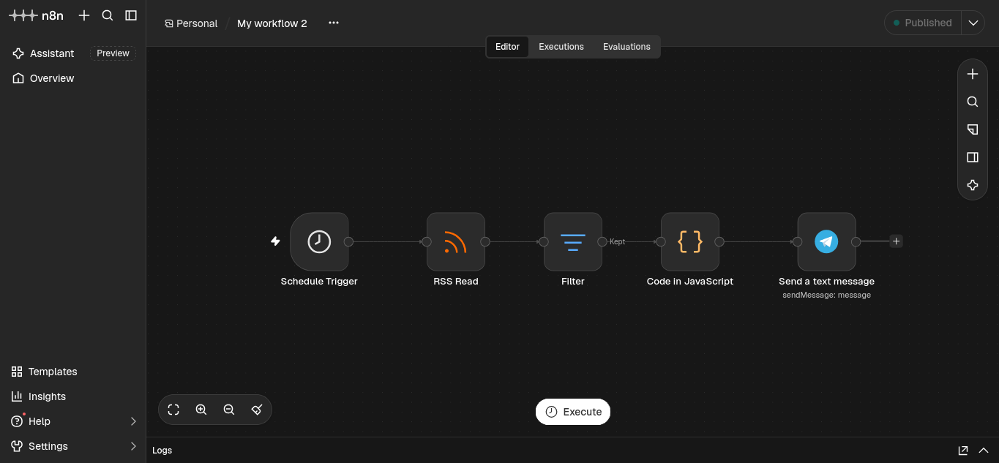
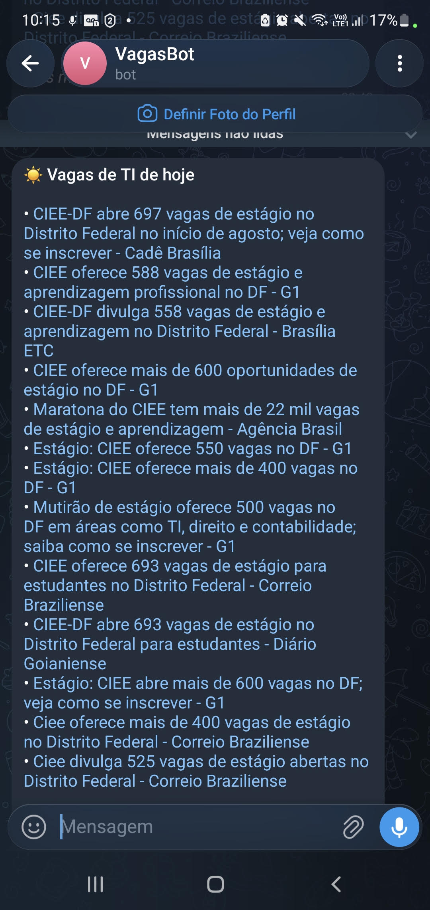

# Resumo Matinal de Vagas de TI no Telegram

Automação feita com **n8n** que, todos os dias às 8h, lê um feed RSS de vagas de estágio em tecnologia no Distrito Federal, filtra os itens da área de TI e envia uma lista organizada no Telegram.

## Problema

Acompanhar vagas de estágio e tecnologia em vários sites, todos os dias, consome tempo. Este projeto entrega o resumo pronto no celular, sem abrir nenhum site.

## Como funciona



**Schedule Trigger → RSS Read → Filter → Code → Telegram**

| Nó | O que faz |
|----|-----------|
| **Schedule Trigger** | Dispara todo dia às 8h (fuso `America/Sao_Paulo`) |
| **RSS Read** | Lê um feed RSS de busca do Google Notícias: `CIEE vagas estágio tecnologia Distrito Federal` |
| **Filter** | Mantém só itens da área de TI, com uma expressão regular que ignora acentos e maiúsculas |
| **Code (JavaScript)** | Junta até 20 itens em uma única mensagem HTML, escapando caracteres especiais |
| **Telegram (Send a text message)** | Envia a mensagem ao chat, com `Parse Mode: HTML` |

### Detalhes do filtro

O texto de cada item (título + descrição) é convertido para minúsculas e sem acentos. O item passa se contiver termos como `desenvolvedor`, `developer`, `programador`, `analista`, `sistemas`, `software`, `python`, `javascript`, `dados`, `automação`, `estágio` ou a sigla `TI` (`\bti\b`, para não casar com palavras como "partida").

A localização (Distrito Federal) é definida na própria busca do feed, na URL do nó **RSS Read**.

## Resultado



## Tecnologias

n8n · Docker · Telegram Bot API · RSS · JavaScript (regex) · Debian Linux (XFCE)

## Como rodar

1. **Instale o n8n com Docker:**
   ```bash
   docker volume create n8n_data
   docker run -d --name n8n --restart unless-stopped \
     -p 5678:5678 \
     -e GENERIC_TIMEZONE=America/Sao_Paulo \
     -e TZ=America/Sao_Paulo \
     -v n8n_data:/home/node/.n8n \
     docker.n8n.io/n8nio/n8n
   ```
2. Acesse `http://localhost:5678` e crie sua conta local.
3. **Crie um bot:** no Telegram, converse com o **@BotFather**, envie `/newbot` e guarde o token.
4. **Descubra seu Chat ID:** mande uma mensagem para o seu bot e abra `https://api.telegram.org/bot<SEU_TOKEN>/getUpdates`. O número está em `"chat":{"id":...}`.
5. No n8n, crie uma credencial **Telegram API** com o token do bot.
6. Importe o arquivo `workflow.json` (*Workflows → Import from file*).
7. No nó do Telegram, selecione a credencial e troque `SEU_CHAT_ID` pelo seu Chat ID.
8. Clique em **Execute workflow** para testar e, depois, **publique** o workflow para ativar o agendamento.

> Nunca coloque o token do bot ou o Chat ID no repositório. O token fica apenas na credencial do n8n.

## Limitações

- O Google Notícias retorna **notícias e páginas indexadas**, não a lista completa de vagas abertas. O link serve de ponto de partida para a candidatura.
- O filtro usa termos amplos (como `dados` e `sistemas`) e pode deixar passar itens que não são vagas.
- O n8n roda localmente: **a automação só dispara com o computador ligado** e o contêiner em execução. Horários perdidos não são recuperados.
- Itens podem se repetir em dias seguidos, pois o feed mantém notícias antigas por um tempo.

## O que aprendi

- Agendamento com cron e configuração de fuso horário no Docker
- Leitura de feeds RSS e filtragem de dados com expressões regulares
- Formatação de mensagens HTML para a API do Telegram
- Agregação de vários itens em uma única mensagem com um nó Code
- Diagnóstico de problemas: feed inválido, erro 403 do Telegram, rede e DNS no Docker
- Segurança: tokens e identificadores pessoais fora do repositório

## Próximos passos

- Adicionar um nó de **IA (LLM)** para resumir cada vaga em uma linha e classificar por relevância
- Usar APIs de vagas com campo de localização (Remotive, Adzuna) no lugar do feed de notícias
- Remover itens repetidos com o nó *Remove Duplicates*
- Combinar vários feeds com o nó *Merge*
- Hospedar em um servidor sempre ligado (Raspberry Pi ou VPS)
